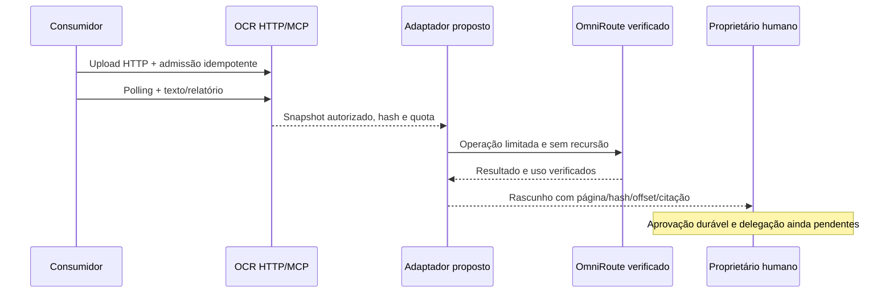

# OmniRoute: plano técnico e runbook

Atividade LPM `J7DhQOqJ58XE4xR2hcWp`. Revisão proposta 1, 19/10/2026. Primeiro alvo da [integração do portfólio](portfolio-integration.md), sujeito aos mesmos gates de governança. Nenhuma integração OCR → OmniRoute está comprovada ou implantada por este documento.

## Duas instalações, evidências distintas

| Alvo | Evidência recebida | O que falta |
|---|---|---|
| Launcher Windows `omni-work.exe`, release `2026.10.14.1`, com SSH ao i9 | Listagem confirmou `local_only=true` e `paid_routes_enabled=false`; reunião literal sintética concluída | Contrato de adaptação ao OCR, autenticação/isolamento e testes de falha; capacidades não ensaiadas precisam de prova própria |
| OmniRoute Web/API na VM114, versão histórica `3.8.51` | Planilha histórica de 14/10, lida em 19/10: `https://omniroute-pilot.tail80929c.ts.net/`, HTTP 200 | Contrato autenticado atual, protocolo, endpoints, modelos, limites, custos e autorização funcional |

HTTP 200 histórico prova somente a resposta observada, não autenticação funcional. Um 401 histórico não demonstra indisponibilidade. Não transferir capacidades, versão ou garantias do launcher para a VM114. Não há contrato autenticado atual confirmado da VM114 nem rotas de provedor habilitadas nesta evidência.

## Capacidades locais informadas

- `reunir`: combinação literal de 1–8 arquivos TXT/MD UTF-8, até 12.000 bytes no total.
- `documentos`: PDF, PNG ou JPEG, até 8 MiB e até 20 páginas; o limite de páginas deve ser verificado conforme a entrada aceita.
- `consulta`: pesquisa no Kiwix local com consulta de 1–200 caracteres.
- `recuperar`: recuperação pelo ID de execução concluída.

Esses nomes descrevem o launcher local; não são ferramentas MCP do OCR nem endpoints da VM114. Confirmar a sintaxe no contrato da release antes de automatizar; este runbook não inventa flags ou caminhos locais.

### Evidência sintética disponível

| Campo | Resultado registrado |
|---|---|
| Execução | `OCR-INT-01-20261019` |
| Operação / projeto | `reunir` / `OCR` |
| Conteúdo preservado | `014/2026` e `R$123,45` |
| Saída | 168 bytes; exit code 0 |
| SHA-256 | `c8cb1bfb72efc3574c4c5d9b0c71aa754d71fd25cd2aac9294bde0cbcd845722` |
| Geração | `model_generation_enabled=false` |
| Revisão | Executor indicava revisão pendente; verificação raiz confirmou os campos literais e o hash |

O ensaio comprova reunião literal naquele fluxo. Não comprova OCR de imagem, RAG, inferência, integração com a aplicação OCR ou autenticação da VM114. Não estender esse resultado a `documentos`, `consulta` ou `recuperar` sem ensaios próprios.

## Descoberta controlada da VM114

Executar somente em ambiente autorizado, inicialmente sem documentos reais e sem habilitar provedores. Segredos permanecem no armazenamento seguro do operador; evidências usam apenas referências e IDs, nunca valores de tokens, cookies ou cabeçalhos sensíveis.

1. Identificar responsável, versão atual, origem permitida, TLS/DNS e horário da sondagem; registrar diferença frente à referência histórica. Acessibilidade de rede não implica autorização de dados.
2. Obter documentação ou export de contrato do operador, com versão/hash. Determinar se há API HTTP, MCP ou outro protocolo e separar interface Web de interface de máquina.
3. Confirmar método de autenticação, identidade individual, escopos, expiração, revogação e isolamento. Usar credencial própria do piloto, sem compartilhamento com o OCR ou outro consumidor.
4. Catalogar somente endpoints declarados: métodos, schemas, limites, códigos, idempotência, polling e cancelamento. **Não presumir que `/v1/chat/completions` exista ou funcione.** Não descobrir contrato submetendo documentos a rotas adivinhadas.
5. Ensaiar uma requisição sintética mínima aprovada. Registrar entrada sem segredo, request/correlation ID, status, duração, versão do contrato e hash da saída. Se a operação gerar custo ou enviar dados a provedor, aguardar admissão específica antes dela.
6. Verificar saída estruturada: JSON válido, schema fechado, campos extras, tamanho máximo e tratamento de respostas truncadas. Distinguir texto livre de suporte nativo a schema; testar sanitização de erros.
7. Medir timeout de conexão/operação, execução síncrona ou assíncrona, recuperação após perda de resposta e comportamento de cancelamento. Confirmar se existe idempotência antes de repetir uma mutação.
8. Determinar identidade efetiva de modelo/provedor e versão, rota escolhida, unidades de uso e custo. Campo ausente fica como desconhecido; não inferir modelo a partir do nome da instalação.
9. Testar bloqueio de rotas pagas e de saída externa, ausência de fallback automático e limites de payload/concorrência. Documentar persistência, TTL, exclusão, logs e localização dos dados.
10. Fechar relatório de compatibilidade com lacunas, responsável e decisão: apto para contrato sintético, bloqueado ou descartado. Resposta Web, autenticação e operação funcional precisam de evidências separadas.

Guardar contrato sanitizado, versão/hash, casos e resultados, configuração sem segredos e decisão de revisão. Se não houver contrato verificável ou contabilização necessária, manter adaptador desabilitado.

## Desenho do adaptador proposto

A entrada de consumidores no OCR usa HTTP/MCP existente; a saída OCR → OmniRoute será componente separado. O launcher não vira rota de modelo por ter reunido arquivos. Escolher explicitamente entre backend local e VM114 somente após provar o contrato correspondente.

Configuração proposta: backend, origem/launcher permitido, versão/hash do contrato, referência de credencial, operações autorizadas, limite de bytes, timeout, concorrência, política de dados e teto de consumo. Validar configuração no startup e falhar fechado. Não aceitar origem, comando, caminho ou modelo arbitrário vindo do texto documental.

O adaptador recebe somente o mínimo autorizado; respostas passam por validação de schema e evidências. Registrar evento de rastreio e identidade de modelo quando efetivamente usados. Para `reunir`, registrar operação literal e geração desabilitada; não fabricar tokens ou modelo. Modelo/uso desconhecidos bloqueiam operações que dependam de controle de custo.

Proibir chamada de retorno ao OCR pelo backend de enriquecimento; validar origem e contador de saltos no despacho, sem confiar em instruções retornadas. Circuit breaker, fila limitada e concorrência finita impedem tempestades de chamadas. Não habilitar nuvem como fallback de falha local.

## Runbook do fluxo OCR existente

1. Provisionar serviço individual pelo administrador humano, sem imprimir segredo. Para submissão e leitura: `jobs:submit`, `jobs:read`, `artifacts:read`; conceder cancelamento/exclusão só se necessários. Serviços distintos não compartilham documentos implicitamente.
2. Consultar `ocr_whoami` e `ocr_get_capabilities`. Escolher opções aceitas; `extract_text` só extrai texto existente. Capacidade anunciada não substitui ensaio de OCR real.
3. Reservar com `ocr_prepare_upload`; persistir o recibo antes de continuar. Enviar PDF por `PUT` HTTP na `content_url` relativa à origem da API, autenticado e por streaming. Confirmar `ready` com `ocr_get_upload`.
4. Submeter por `ocr_submit_job`, persistindo `upload_id`, chave e opções. Após timeout, repetir a mesma chave e opções; o recibo é histórico. Consultar estado com `ocr_get_job`, respeitando `poll_after_seconds`, sem manter uma chamada aberta por todo o processamento.
5. Em conclusão, percorrer `ocr_get_text` por página/offset, consultar `ocr_get_report` e baixar `ocr_get_artifact` por HTTP na origem autorizada. Conferir SHA-256 do PDF com `report.output.sha256`; falha de integridade impede entrega.
6. Somente após os gates do adaptador, preparar snapshot mínimo e manifesto proposto. Respeitar limite específico do backend: a reunião local de 12.000 bytes não comporta automaticamente um documento inteiro; qualquer seleção deve ser explícita e rastreável, sem truncamento oculto.
7. Validar resposta como rascunho E3, com citações verificadas contra página/hash/offset. Aprovação humana, XMP, indexação e recibo durável dependem das entregas governadas E2–E6; não simular essas funções com um arquivo avulso.
8. Quando E5 existir, conferir ACK com hashes e persistir recibo antes da limpeza coordenada. Hoje, o TTL do OCR segue independente; obter resultados antes do vencimento. Exclusão explícita aceita apenas job terminal e exige `artifacts:delete`; acompanhar `purge_pending`.

## Falhas e recuperação

| Situação | Conduta |
|---|---|
| Reserva de upload com resposta perdida | Reconciliar execução; reserva não é idempotente e repeti-la consome quota |
| Admissão com resposta perdida | Repetir mesma chave/corpo; consultar job atual separadamente do recibo |
| Backend sem idempotência comprovada | Não repetir mutação incerta; reconciliar pelo mecanismo documentado ou revisão manual |
| 401/403 | Corrigir identidade/concessão; não alternar para segredo compartilhado ou administrador |
| 409 | Distinguir conflito, resultado ainda não pronto e estado inválido; não trocar chave para ocultar conflito |
| 410 | Encerrar acesso ao artefato; reconciliar retenção/recibo; nova admissão só por decisão autorizada |
| 429, timeout ou falha transitória | Até três tentativas totais, com backoff limitado, somente se repetição for segura; respeitar indicação de espera |
| Schema/hash divergente ou evidência insuficiente | Quarentenar rascunho, interromper entrega/indexação e registrar erro sanitizado |
| Teto, fila cheia ou circuito aberto | Recusar/adiar novo despacho com estado visível; não ativar fallback pago |
| Tentativas esgotadas | Fila de falhas persistente proposta; replay manual autorizado preserva correlação e chaves aplicáveis |

Polling continua suportado. Fila de falhas, reconciliação do adaptador, outbox e webhooks assinados exigem implementação; não são garantias do runtime atual. Não guardar conteúdo sensível em mensagens de erro ou logs de rastreio.

## Gates de liberação

- **Fase 1 — contrato:** concluir C5 e requisitos E2 aplicáveis; decidir delegação para documentos de serviço sem impersonação; provar backend escolhido e cobertura API/MCP. Executar testes sintéticos de schemas, autenticação, escopos, isolamento, recursão, custo, quota, retenção/410, timeout e recuperação. Ensaiar capacidades locais separadamente.
- **Fase 2 — canário:** uma integração, documentos sintéticos e concorrência mínima; testar falhas de disco/rede, resposta perdida, recibo/ACK e replay. Exigir decisão de privacidade e custo antes de dados reais ou inferência. Outbox/webhook é opcional nesta fase, com assinatura e deduplicação testadas.
- **Fase 3 — expansão:** liberar por consumidor com benefício medido, dono e contrato. Testar ACL/citações de RAG antes de indexar; manter parada imediata por fuga de dados, divergência de hash, recursão ou estouro de teto.

Rollback desabilita enriquecimento e novos despachos, conserva processamento OCR existente, recibos e auditoria, e reconcilia operações em voo antes de replay. Não desfaz envios já aceitos por destinatários; tratar cópias conforme contrato e ACL. Credenciais comprometidas devem ser revogadas individualmente.

O orçamento permanece **USD 180**; não há reserva ou aprovação automática de IA de serviços. Esta proposta não executa sondagem, deploy, envio à nuvem ou mudança de provedor. A única prova funcional informada é a reunião literal local descrita acima.
