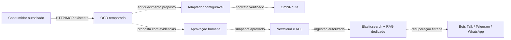

# Integração do OCR ao portfólio

Atividade LPM `J7DhQOqJ58XE4xR2hcWp`. Plano documental de 19/10/2026, revisão proposta 1. Preparar todo o OCR para integrações, começando pelo OmniRoute, com evolução governada. Este documento não altera runtime nem comprova integração ativa.

## Fontes e limites da evidência

- [Planilha original](https://docs.google.com/spreadsheets/d/1i2KDEK0ZfWrVsq_iqWapRZzZCwf1dxGeJXu9AfkuWF0/edit), leitura informada de 19/10/2026: aba `Portf?lio IA`, A1:I50, conteúdo histórico de 14/10/2026. O nome da aba é preservado conforme a fonte recebida.
- Aba `Serviços`, A1:L70: amostra parcial com Combinado, Medusa e MWG e referências HTTP/MCP; não constitui inventário completo nem contrato autenticado de cada serviço.
- Não foi fornecida revisão imutável ou hash da planilha. Na implementação, registrar export datado, intervalo, hash e responsável pela leitura, sem substituir a proveniência histórica por disponibilidade atual.
- Contratos implementados: [HTTP](http-contract.md), [MCP](mcp-workflow.md), [identidades](service-identities.md), [capacidades](capabilities.md), [resultados](results.md) e [retenção](retention.md). Contagens antigas nesses documentos são históricas; o contrato HTTP consolidado informa 44 operações e 34 ferramentas MCP.
- Evidência local do OmniRoute e sua separação da VM114: [runbook específico](omniroute-integration.md). Não houve consulta adicional às fontes nesta proposta.

## Arquitetura e autoridade

Nextcloud é o acervo definitivo e a autoridade de ACL. OCR mantém processamento e artefatos temporários; seu proprietário técnico não substitui as permissões do acervo. Elasticsearch atende busca lexical; RAG dedicado atende recuperação vetorial. Talk, Telegram e WhatsApp são canais de bots, sujeitos à mesma autorização documental.



Linhas pontilhadas são fluxos planejados, sem comprovação de implantação. A entrada consome a API/MCP existente; a saída de enriquecimento depende de adaptador, contrato remoto verificado e admissão de orçamento/privacidade. Bloquear ciclos OCR → OmniRoute → OCR por origem, correlação e limite de saltos; o adaptador de saída não recebe capacidade de submeter novamente ao OCR.

## Matriz do portfólio

Categorias: **D** consumidor direto de documentos; **E** rota de enriquecimento; **V** apoio ao desenvolvimento; **O** opcional, sem integração direta justificada. A categoria descreve o uso proposto, não uma API existente. P0 inicia descoberta; P1 depende do núcleo governado; P2 exige caso de uso; P3 não abre integração agora.

| Ferramenta | Categoria / prioridade | Interface proposta | Estado da fonte / lacuna para avançar |
|---|---|---|---|
| OmniRoute | E / P0 | Adaptador de saída após descoberta; consumo de OCR separado | VM114 Web/API histórica; launcher local distinto comprovou somente reunião literal; falta contrato autenticado remoto |
| Open Notebook | D / P1 | Entrega autorizada de texto/PDF e manifesto | Ollama qwen3:14b e bge-m3 citados; confirmar importação, ACL, recibo e retenção; não presumir endpoint |
| Book to Skill | D / P1 | Pacote documental aprovado para processamento explícito | Ferramenta listada; verificar formatos e execução, autoria e destino das skills |
| OpenResearch | D / P2 | Documentos aprovados com citações | Listado; confirmar necessidade, importação, identidade e segregação |
| MiroFish | E / P2 | Enriquecimento de snapshot autorizado | Zep/Ollama citados; confirmar protocolo, persistência, exclusão e custo |
| No AI Slop | V / P2 | Revisão editorial de documentação selecionada | Listado; sem justificativa para acesso automático ao acervo |
| Strix | V / P2 | Avaliação de segurança em ambiente de teste | Listado; escopo e autorização devem ser definidos; sem acesso documental por padrão |
| OpenSEO | O / P3 | Nenhuma agora | Erro DataForSEO e pausa históricos; reavaliar caso de uso antes de contrato |
| I Have ADHD | O / P3 | Nenhuma agora | Listado; benefício documental e interface não demonstrados |
| AI Job Search | O / P3 | Nenhuma agora | Listado; exige caso específico e decisão sobre dados pessoais |
| Open Generative AI | O / P3 | Nenhuma agora | Créditos MuAPI citados; não equivalem a orçamento aprovado nem necessidade OCR |
| Atlas | O / P3 | Nenhuma agora | Listado; finalidade documental e contrato não estabelecidos |
| Pi | O / P3 | Nenhuma agora | Listado; finalidade documental e contrato não estabelecidos |

Combinado, Medusa e MWG entram numa descoberta posterior de serviços: registrar consumidor, proprietário, protocolo efetivo e contrato antes de atribuir integração. n8n e outros orquestradores são candidatos; esta leitura não prova instalação. Cada ferramenta precisa demonstrar benefício próprio; não há compromisso de adoção uniforme. Respostas 401 históricas indicam exigência de autenticação e não bastam para classificar um serviço como falho.

## Contratos disponíveis e evolução pendente

Hoje: HTTP v1 e MCP admitem uploads/jobs, consultas, resultados e controle com escopos e posse. Reservar upload não é idempotente; submissão exige chave. Bytes entram por HTTP, não por caminho local ou base64 MCP. Polling respeita `poll_after_seconds`. Texto é paginado por página/offset; relatório oferece proveniência e hashes. Capacidades limitam modos/idiomas; não há downgrade silencioso para extração.

Templates e catálogo de contexto/tipo já possuem operações, versões e hashes; isso não entrega metadados de documentos. A vinculação no DocumentService permanece pendente. E2 dispõe de política/esquema de aprovação pura aceitos; aprovação durável, índice, recibo, quota, recuperação e atendimento a serviços continuam pendentes. API, MCP e UI de metadados não devem ser anunciados como disponíveis.

| Etapa | Trabalho proposto / condição de aceite |
|---|---|
| E2 — governança | Persistir aprovação humana, snapshot e hash exatos, histórico, quotas e recuperação; completar API/MCP/UI e vínculo documental antes de publicar metadados |
| E3 — sugestão LLM | Produzir valores propostos com página, hash do texto, offset e citação; validar esquema e evidência; revisão humana antes de promover rascunho |
| E4 — PDF final | Inserir XMP antes da validação PDF/A final e do hash final; guardar proveniência e validar externamente; o `not_validated` atual não comprova conformidade |
| E5 — entrega | Obter confirmação do destinatário com hashes exatos e gravar recibo durável antes de iniciar limpeza por TTL do fluxo proposto |
| E6 — recuperação | Indexar somente snapshot aprovado e hash correspondente, com ACL; RAG/GraphRAG filtram permissões antes da recuperação e fornecem citações verificáveis |

O TTL atual do OCR não espera confirmação externa. E5 precisa de coordenação persistente e prazo de entrega inferior à retenção, ou de mudança governada dessa política; não prometer preservação indefinida. GraphRAG é opção posterior, condicionada a benefício e isolamento comprovados.

## Manifesto e recibo propostos

Formato ilustrativo `portfolio-document/1`, ainda sem endpoint ou schema implantado. Hashes abaixo são marcadores a substituir por SHA-256 hexadecimais de 64 caracteres. Não incluir caminhos da máquina de origem, URLs com credenciais ou segredos.

```json
{
  "schema_version": "portfolio-document/1",
  "document_id": "doc-sintetico-01",
  "job_id": "00000000000000000000000000000001",
  "state": "draft",
  "metadata_schema": {"context_id": "contexto-id", "type_id": "tipo-id", "version": 1, "schema_sha256": "<sha256-schema>"},
  "metadata": {"numero": "014/2026"},
  "evidence": [{"field": "numero", "page": 1, "text_sha256": "<sha256-texto-pagina>", "offset": 0, "quote": "014/2026"}],
  "artifacts": [{"kind": "pdf", "sha256": "<sha256-pdf-final>", "size_bytes": 1024}],
  "trace": {"event_id": "evt-sintetico-01", "correlation_id": "corr-sintetico-01", "event": "metadata_proposed"}
}
```

Offsets seguem pontos de código Unicode do texto da página; a citação deve coincidir com o trecho no hash indicado. Aprovação gera snapshot imutável separado; edição posterior volta a rascunho e exige nova aprovação.

```json
{
  "schema_version": "portfolio-receipt/1",
  "receipt_id": "recibo-sintetico-01",
  "recipient_id": "destinatario-id",
  "document_id": "doc-sintetico-01",
  "state": "approved",
  "approved_snapshot_sha256": "<sha256-snapshot-aprovado>",
  "manifest_sha256": "<sha256-manifesto>",
  "artifact_sha256": ["<sha256-pdf-final>"],
  "acknowledged_at": "2026-10-19T12:00:00Z",
  "trace_event_id": "evt-sintetico-02"
}
```

Definir serialização canônica e bytes cobertos por cada hash antes de implementar; o hash do manifesto fica no recibo para evitar autorreferência. O estado `approved` exige referência à aprovação humana durável. Um ACK de transporte ou um 200 sem verificação do destinatário não satisfaz E5.

## Segurança, operação e orçamento

Uma identidade de serviço por integração, com concessões mínimas: leitura de resultados usa `jobs:read` + `artifacts:read`; `jobs:submit`, `jobs:cancel` e `artifacts:delete` somente quando necessários. Catálogo exige seus escopos próprios, conforme o contrato. Administrar identidades não concede leitura documental; rotação mantém o mesmo principal.

Serviços não aprovam metadados: a decisão é do proprietário humano via JWT/OAuth validado. Delegação humana para documentos pertencentes a serviço está sem solução contratual; não usar impersonação, transferência implícita ou credencial de administrador como atalho. Essa lacuna bloqueia o fluxo correspondente.

Texto, nomes e respostas de modelos são dados não confiáveis. Validar esquema fechado, evidências e tamanho; não executar instruções recuperadas. Controlar concorrência finita, fila limitada, backpressure e quotas por integração. Aplicar timeout, circuit breaker e retries limitados; repetir a mesma chave e corpo apenas nas mutações idempotentes suportadas. Reserva de upload incerta exige reconciliação, não repetição cega.

Polling é o mecanismo atual. Outbox persistente e webhook assinado são proposta opcional da fase 2, com deduplicação, proteção contra replay e rotação de chave; não anunciar eventos existentes. Esgotados os retries, gravar falha sanitizada em fila de falhas e permitir replay manual autorizado. Respostas 410 exigem encerrar a leitura e reconciliar recibos, nunca contornar retenção.

Orçamento atual: **USD 180, inalterado**. Orçamento de desenvolvimento não reserva nem aprova consumo de IA de serviços. Antes de enriquecimento, definir teto por requisição/período, contabilização, modelo e política de dados. Sem deploy, envio de documentos à nuvem, segredos compartilhados ou fallback automático para provedor pago.

## Rollout em três fases

1. **Preparar e provar contratos:** concluir C5 com evidência de aceite no plano governado; fechar lacunas E2 e delegação necessárias ao piloto; verificar contrato OmniRoute, manifesto/recibo, ACL, orçamento e cobertura API/MCP. Executar testes sintéticos de contrato, autenticação, escopos, isolamento, custo, retenção/410, timeout, quota e recuperação. Sem esses requisitos, limitar-se à descoberta local.
2. **Canário controlado:** usar documentos sintéticos, uma integração e concorrência mínima; comparar hashes, sugestões, aprovação, ACK e exclusão. Só ampliar a dados autorizados após aceite explícito. Se necessário, implementar e testar outbox/webhook nesta fase. Registrar critério de parada por fuga de ACL, hash divergente, recursão ou estouro de teto.
3. **Ampliar por benefício comprovado:** habilitar consumidores individualmente, com contrato e responsável, métricas de utilidade, custo, latência, erros e recibos. Liberar busca/RAG somente com filtragem e citações testadas. Reverter desabilitando o adaptador e novos despachos, preservando recibos, fila e auditoria para reconciliação; revogar credenciais comprometidas e não apagar evidência para simular rollback.
